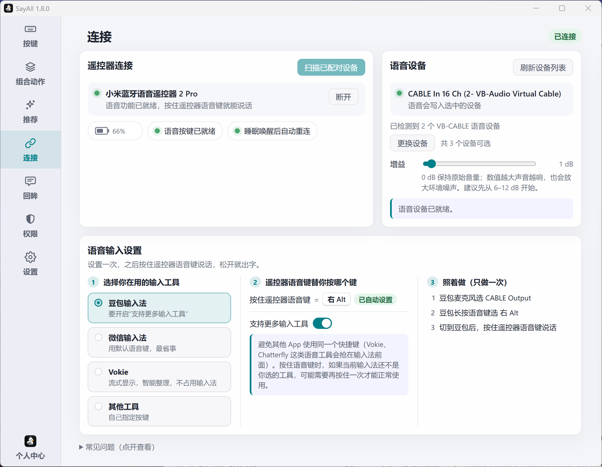

# 无线麦 SayAll for Windows

<p align="center">
  
</p>

<p align="center">小米蓝牙遥控器的可视化按键映射</p>

[微博](https://weibo.com/getSayAll) · [官网](https://sayall.app/)

<table>
  <tr>
    <td align="center">
      <a href="Screenshots/douyin-sayall.jpg"></a><br>
      <strong>抖音 · GetSayAll</strong><br>
      保存图片后，在抖音扫一扫
    </td>
    <td align="center">
      <a href="Screenshots/xhs-sayall.jpg"></a><br>
      <strong>小红书</strong><br>
      扫码关注无线麦
    </td>
  </tr>
</table>

## 视频介绍

《可能是我最近用过最不像工具的工具》展示了无线麦如何把蓝牙语音遥控器变成随手表达、控制电脑和与 AI 协作的新入口。视频中的产品界面以当时展示版本为准。

<p align="center">
  <a href="https://www.bilibili.com/video/BV13Pep6BEXe">
    
  </a>
</p>

<p align="center"><a href="https://www.bilibili.com/video/BV13Pep6BEXe">点击封面或前往 Bilibili 观看原视频</a></p>

视频作者：[可乐不甜的跑焦日记](https://space.bilibili.com/327214328)

无线麦 SayAll Windows 版让小米蓝牙遥控器在电脑上帮你说话、顺手干活：按住遥控器语音键说话，文字直接出现在正在使用的输入框；遥控器按键可以设置成常用快捷键，或用来打开某个应用。

支持两种型号，均已在 Windows 上完成真机适配：

- 小米蓝牙遥控器 2（RC001）
- 小米蓝牙遥控器 2 Pro（RC003）

## 主要功能

- **按住说话**：按住遥控器语音键说话，松开后文字出现在输入框。支持豆包输入法、微信输入法、Vokie 和其他语音工具，选好工具后应用会自动配好快捷键和准备步骤。
- **按键映射**：每个按键的单击、双击、长按都能分别设置，可以映射为常用快捷键，或用来打开应用。
- **全按键支持**：开启后，返回、音量+、音量− 也能自定义。每次开启 Windows 都会弹出授权询问，请选择“是”。
- **省心的连接**：自动记住你的遥控器和语音设备；断连、睡眠唤醒后自动恢复。
- **个性化设置**：外观跟随系统或手动选择深浅色、登录时自动启动、应用图标切换、检查更新。
- **配置备份**：按键映射可导出为文件，换电脑时导入即可用。
- **问题反馈**：权限页可一键生成诊断摘要（不含设备地址与语音内容），随问题一起提交。

两种型号的按键映射都已在 Windows 真机上验收通过。当前为预览版本：安装包还没有 Windows 代码签名，首次运行时可能出现 SmartScreen 提示，按安装指南说明继续即可。

## AI 一键安装（Agent 提示词）

不熟悉 Windows 设置也可以：把下面这段提示词整段复制给豆包、DeepSeek 等 AI，它会先确认电脑和遥控器是否符合要求，再一步一步带你安装、配对、设置语音输入，最后验证能不能出字。

- 能操作电脑的 AI 可以直接完成检查、下载和安装中能自动完成的部分；只能聊天的 AI 会告诉你每一步点哪里。
- 需要你本人确认的步骤（安装 VB-CABLE 时 Windows 弹出的询问、蓝牙配对、重启电脑）它会停下来等你。
- 安装包只从官方 [GitHub Releases](https://github.com/GetSayAll/remote-mic-app-windows/releases) 下载；GitHub 打不开时，用下方「用户安装与配置」里的百度网盘备份。任何让你关闭 SmartScreen、杀毒软件或系统安全设置的说法都不要照做。

<details>
<summary><strong>点开复制「SayAll 一键安装」提示词</strong></summary>

```text
你是我的 Windows 安装向导。请用简单的中文，少用术语；必须用时先用一句话解释。一步一步帮我在当前这台电脑上安装并配置「无线麦 SayAll Windows 版」，直到我用遥控器说话能真正打出字。

开始前先说明你的能力：如果你只能聊天，不要假装执行命令，只告诉我点哪里、输入什么，然后等我回复结果；如果你能操作这台电脑，可以先做检查、下载和安装，但每次动手前先说明要做什么，得到我同意再做。

产品事实：
- 支持 64 位 Windows 10 1809（内部版本 17763）或更高版本。ARM64 电脑上，基础语音和按键可用，“全按键支持”暂不可用。
- 遥控器只支持小米蓝牙语音遥控器 2（RC001）和小米蓝牙语音遥控器 2 Pro（RC003）。
- 安装包优先从官方 GitHub Releases 下载：https://github.com/GetSayAll/remote-mic-app-windows/releases。选最新的预览版（或最新正式版），文件名是 SayAll-Windows-<版本号>-x64-setup.exe。不要下载 latest.json 或 .sig，也不要从软件站或搜索结果里的其他地址找安装包。
- 如果 GitHub 打不开，停下来告诉我，我会按项目 README（https://github.com/GetSayAll/remote-mic-app-windows）里的百度网盘备份下载。
- 官方安装指南：https://github.com/GetSayAll/remote-mic-app-windows/blob/main/docs/installation-and-configuration.md
- 这份提示词和官方安装指南冲突时，以官方安装指南为准。
- 下载后以官方 Releases 页的 SHA256SUMS.txt 为准核对 SHA-256：在安装包所在文件夹打开 PowerShell，运行 Get-FileHash -Algorithm SHA256 .\SayAll-Windows-*-x64-setup.exe，再和文件里的值对比。对不上就停止安装。
- 如果 Windows 提示“Windows 已保护你的电脑”，只有在确认安装包来自上面的官方 Releases、并且 SHA-256 一致时，才让我点“更多信息 → 仍要运行”。不要让我关闭 SmartScreen、杀毒软件或任何安全设置。
- SayAll 按当前用户安装，日常不要用管理员身份运行。只有安装 VB-CABLE 时需要管理员权限。

请按这个顺序做。每一步先告诉我目的和怎样算完成，再给操作；我确认后再进入下一步：
1. 检查系统：Windows 版本、是否 64 位、蓝牙是否已打开、网络是否可用、遥控器是否在身边且电池有电。
2. 下载安装包，并从官方 Releases 页取得 SHA256SUMS.txt，核对 SHA-256，然后安装 SayAll。
3. 配对遥控器：打开 Windows“设置 → 蓝牙和设备 → 添加设备 → 蓝牙”，同时长按遥控器的“菜单 + 主页”键，直到它出现在列表里；没反应就按遥控器说明书进入配对模式，不要反复快速按键。遥控器如果还连着电视或盒子，先关掉那台设备的蓝牙。配对由我本人操作。
4. 如果要用遥控器说话：从 https://vb-audio.com/Cable/ 下载 VB-CABLE，解压后右键 VBCABLE_Setup_x64.exe，选择“以管理员身份运行”，再选择 Install Driver；完成后重启电脑。Windows 弹出的询问和重启由我本人确认。
5. 打开 SayAll，跟随首次设置向导；如果没有向导，打开“连接”页，扫描并连接遥控器，确认显示 RC001 或 RC003；语音设备选择带“推荐”标记的 CABLE 播放端（CABLE Input 或 CABLE In 16 Ch）。
6. 配置语音输入：如果还没选，先问我在用哪个工具（豆包输入法、微信输入法、Vokie 或其他）。按 SayAll“语音输入设置”的第 ③ 步准备；用豆包时必须在第 ② 步打开“支持更多输入工具”。麦克风选 CABLE Output。豆包和 Vokie 都用右 Alt，二者只开一个。
7. 验证：按住遥控器语音键说话，松开后看当前输入框有没有出字。没有出字时，按 SayAll 页面上的提示排查；连接异常先等约 60 秒自动恢复，不要先重启电脑、重启蓝牙或重新配对。
8. 基础语音通过后，再问我要不要设置按键映射或“全按键支持”。开启“全按键支持”时 Windows 会弹出授权询问，选“是”。

必须遵守：
- 只在 SayAll 的可见界面里配置，不要直接改它的设置文件，也不要读写其他软件的私有配置、数据库或内存。
- 不要读取、记录或发送我的蓝牙地址、设备路径、语音内容或个人路径。
- 不要替我做 Windows 弹出的询问、SmartScreen、蓝牙配对和重启电脑；这些必须由我本人确认。
- 不要安装来源不明的软件或脚本。
- 最后告诉我：SayAll 版本、遥控器型号、连接 / 语音按键 / 语音设备 / 按键监听四项是否“已就绪”、实际出字是否成功，以及还有哪些步骤没完成。
- 做不到的步骤直接说“这一步需要你来做”，给出具体点击位置，不要跳过，也不要假装成功。
```

</details>

手动安装步骤见下方的[安装与配置指南](docs/installation-and-configuration.md)。

## 用户安装与配置

备用下载：[百度网盘](https://pan.baidu.com/s/1yuBRBCDEWnnwfzbxye5rnQ?pwd=9qhx)，提取码：`9qhx`。

首次安装、遥控器配对、语音软件设置、按键映射、更新和排障步骤，见 [安装与配置指南](docs/installation-and-configuration.md)。各版本的更新内容见 [GitHub Releases](https://github.com/GetSayAll/remote-mic-app-windows/releases)。

<p align="center">
  
</p>

<p align="center">连接遥控器，选择语音设备与输入工具</p>

## 参与开发

开发环境、构建与本地检查流程见 [DEVELOPMENT.md](DEVELOPMENT.md)。

## 特别致谢

无线麦 SayAll App 由 DimAgent 与 Vokie 友情赞助，感谢两位朋友，让好工具被更多人用上。

无线麦 SayAll Windows 版本通过 DimAgent 完成开发。

- **DimAgent**：调度多模型团队，构建你想要的一切 → [dimagent.cn](https://dimagent.cn/?utm_source=sayall.app)
- **Vokie**：首选语音助理，语音输入、闪记、旁听，直接给你可用结果 → [vokie.com](https://vokie.com/?utm_source=sayall.app)

## 赞赏

<p align="center">
  
</p>

<p align="center">微信赞赏码</p>

## 开源协议

程序代码使用 GPL-3.0-only。App Logo 和 App Icon 是保留版权的专有品牌资产，不属于 GPL-3.0-only 授权范围；详见 [LOGO-LICENSE.md](LOGO-LICENSE.md)。第三方来源与素材边界见 [ATTRIBUTION.md](ATTRIBUTION.md) 和 [THIRD_PARTY_NOTICES.md](THIRD_PARTY_NOTICES.md)。
